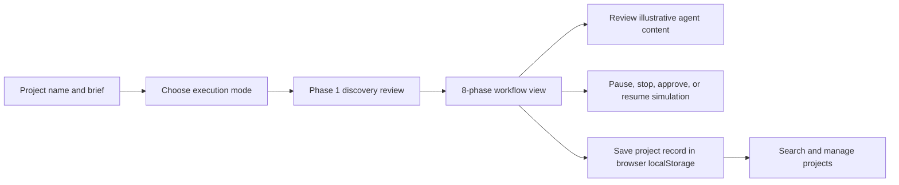
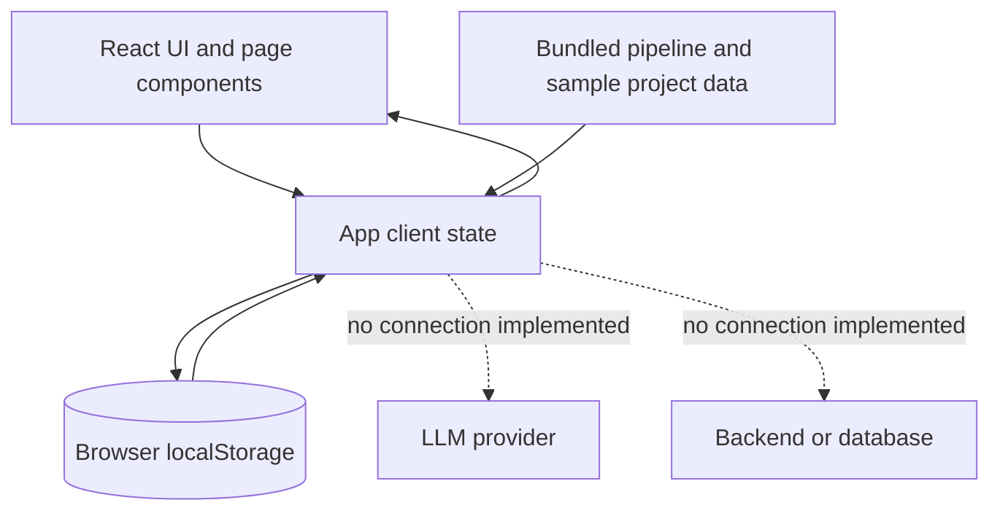

# Design Studio

**From dreams to design.**

Design Studio is a front-end prototype for organizing early product ideas into a structured design workflow. It gives a project team a single place to record a brief, clarify discovery context, follow a staged product-design process, and review illustrative agent outputs and project progress.

> **Current status:** This repository contains a browser-based prototype, not a production AI orchestration service. No LLM, backend API, database, authentication provider, or external integration is connected. Workflow progress is simulated in the client, and the agent content is bundled illustrative data. See [Current implementation and limitations](#current-implementation-and-limitations).

## At A Glance

- **Product:** Design Studio
- **Tagline:** From dreams to design
- **Workflow model:** 8 phases and 19 named sub-agents
- **Application:** React + TypeScript single-page app, built with Vite
- **Persistence:** Browser `localStorage` for project records
- **Execution:** Local status simulation; no model inference
- **License:** No project-level license file is currently present. See [Attributions](#attributions).

## Product Overview

Product discovery and design work can become fragmented across briefs, research notes, decisions, and handoff materials. Design Studio explores a more structured experience: capture the project context, make decisions and progress visible, and organize the work into a sequence from discovery through final delivery.

The intended audience is product teams and people shaping digital products who need a clearer path from an initial idea to a reviewed design direction and handoff. The current application demonstrates that workflow and its interface. It does **not** yet generate research, strategy, designs, or other deliverables through AI.

## How The App Works

1. **Create a project.** Enter a project name, a short project summary, and additional brief details. A file can be selected in the upload area.
2. **Choose an execution mode.** Select Human Interaction or AI Autonomous. In the current prototype, these modes control how the simulated workflow advances; they do not invoke separate AI capabilities.
3. **Complete Phase 1 discovery.** Human Interaction mode presents a fixed set of discovery questions. AI Autonomous mode skips the interview and opens the summary for review. The discovery summary is assembled in the browser from the submitted brief and answers; it is not generated by an AI model.
4. **Review project progress.** The project view shows the 8-phase pipeline, sub-agent statuses, and example logic and deliverable content bundled with the application.
5. **Control the simulated run.** Human Interaction mode waits for approval after each simulated sub-agent. AI Autonomous mode advances automatically. Pause and Stop take effect after the current simulated task completes; Resume moves to the next pending task.
6. **Manage projects.** Search, filter, sort, switch between grid and list views, open, duplicate, delete, and download a project blueprint as JSON from the project list.



## Workflow: 8 Phases, 19 Sub-Agents

The names and groupings below come from `src/app/data/pipelineData.ts`. Deliverable labels are part of the bundled prototype data; they are not evidence that files are generated by live agents.

| Phase | Focus | Sub-agents and example deliverables |
| --- | --- | --- |
| **1. Product Discovery & Strategy** | Frame the opportunity and intended direction. | **1.1 Info Gathering Agent** — Structured Requirements JSON; **1.2 Market Analysis Agent** — Competitive Analysis Report; **1.3 Strategy Agent** — Strategic Design Brief |
| **2. User Research & Validation** | Understand user needs and map experiences. | **2.1 User Research Agent** — User Research Synthesis; **2.2 Journey Mapping Agent** — Journey Maps & Service Blueprints |
| **3. Information Architecture & Wireframing** | Organize information and establish structural layouts. | **3.1 IA Agent** — Sitemap & IA Documentation; **3.2 Wireframe Agent** — Wireframe Set (Figma); **3.3 Accessibility Review Agent** — Accessibility Audit Report |
| **4. Visual Design & Design System** | Define visual foundations and interface direction. | **4.1 Design System Agent** — Design System Foundation (Figma + Tokens); **4.2 Visual Design Agent** — High-Fidelity Mockups (Figma) |
| **5. Prototyping & Interaction Design** | Specify interactions and prototype behavior. | **5.1 Prototype Agent** — Interactive Prototype (Figma); **5.2 Interaction Specification Agent** — Interaction Specification Docs |
| **6. Usability Testing & Iteration** | Evaluate usability and refine the design. | **6.1 Usability Test Agent** — Usability Test Report; **6.2 Iteration Agent** — Revised Mockups & Prototype |
| **7. Developer Handoff & Documentation** | Prepare implementation guidance and design assets. | **7.1 Design Spec Agent** — Developer Handoff Package; **7.2 Asset Export Agent** — Design Asset Library |
| **8. QA & Final Delivery** | Review quality and package final materials. | **8.1 Design QA Agent** — Design QA Report; **8.2 Documentation Agent** — Final Documentation Package; **8.3 Knowledge Transfer Agent** — Knowledge Transfer Package (Video + Live Session + Docs) |

## Execution Modes And Controls

### Human Interaction

The prototype asks the user a fixed set of six discovery questions, allows the discovery summary to be reviewed, and waits for the user to approve the next sub-agent after each simulated task completes. This is a deterministic interface flow; the questions do not adapt based on an LLM.

### AI Autonomous

The prototype skips the question-by-question interview, builds a summary from the submitted brief, marks missing topics as unverified assumptions, and advances through the simulated sub-agents automatically. **It does not currently call an AI model or autonomously reason about the project.**

### Pause, Stop, And Resume

- **Pause** requests that the current simulated task finish, then saves the project in Draft with a paused state.
- **Stop** requests that the current simulated task finish, then saves the project in Draft with a stopped state.
- **Resume** reactivates the next pending sub-agent.
- In Human Interaction mode, completing a simulated sub-agent normally pauses for approval before the next one starts.

Each simulated sub-agent runs on a client-side timer (currently five seconds). This timing is only a prototype interaction and does not represent real task duration.

## Product Capabilities In The Prototype

- Responsive project dashboard with grid and list layouts.
- Project search, status filters, sorting, and phase progress display.
- Project creation with project name, short summary, additional brief text, and file selection.
- Discovery interview and editable discovery summary for Phase 1.
- Human Interaction and AI Autonomous workflow modes as described above.
- Workflow status controls: approve next, pause, stop, and resume.
- Open, duplicate, delete, and JSON blueprint download actions in the project list.
- Settings page with General, Agents Configuration, Notifications, and Integrations tabs. Notifications and integrations currently show placeholder content; General settings and agent configuration are client-side interface state and are not persisted as server settings.
- Light/dark theme controls and an About page.

## Technology And Architecture

The application is a client-rendered single-page app. `src/main.tsx` mounts the React application; `src/app/App.tsx` coordinates views, project state, discovery, and the simulated workflow. UI components are organized under `src/app/components`, workflow sample data under `src/app/data`, and shared application types under `src/app/types`.

| Area | Implementation |
| --- | --- |
| UI runtime | React 18, TypeScript, Vite 6 |
| Styling | Tailwind CSS 4, CSS variables, Roboto |
| UI components | shadcn-style components built on Radix primitives |
| Icons and feedback | Lucide React and Sonner |
| Theme | `next-themes` with light/dark theme support |
| Workflow data | Static TypeScript data in `src/app/data/pipelineData.ts` |
| Persistence | Browser `localStorage`; no remote service |



## Data, Persistence, And Privacy

- Project records are stored under the `design-studio-projects` key in browser `localStorage`. They are available only to the same browser profile and site origin; they are not synchronized to another browser or device.
- Clearing site data, using private browsing, or disabling browser storage can remove or prevent persistence. The app falls back to bundled sample projects when no valid project list is available in storage.
- Entered project summary, brief text, discovery summary, workflow state, and attachment **name** may be included in the local project record.
- Selecting a file does not upload it to a server. The current project record stores its filename, not the file contents.
- The repository contains no backend or model API integration. No server-side account, team workspace, backup, or cross-device sync is implemented.
- Do not treat this prototype as a secure repository for confidential or regulated information. A production release would need a reviewed data-handling design and appropriate security controls.

## Local Development

### Prerequisites

- Node.js with npm
- Git, if cloning the repository

### Install and run

```bash
git clone <repository-url>
cd <repository-directory>
npm install
npm run dev
```

Vite prints the local development URL in the terminal after startup.

### Production build

```bash
npm run build
```

The production bundle is written to `dist/`. The repository currently defines `dev` and `build` scripts; it does not define a test, lint, or type-check script.

## Configuration And Deployment

There are no application environment variables or backend secrets configured in this repository. The current app is a Vite static front end and the production build can be hosted by a static web host that serves the generated `dist/` files. No deployment provider configuration is included, so provider-specific deployment steps, domain setup, and production readiness have not been verified here.

The HTML currently includes `noindex, nofollow`; search engines are explicitly asked not to index the application. Review this setting before any public launch.

## Accessibility And Design

The interface uses semantic HTML elements, labels, accessible names for key controls, keyboard-accessible Radix-based components, responsive layouts, and light/dark theme styling. These implementation choices do not replace a formal accessibility audit. Contrast, keyboard flows, screen-reader behavior, and mobile layouts should be tested against the actual release requirements before launch.

## Current Implementation And Limitations

The following are known boundaries of the current code, not roadmap features:

- There is no LLM inference, agent orchestration engine, or AI provider integration.
- Agent statuses advance through a five-second browser timer. The logic, decisions, and deliverable descriptions shown in agent views are static sample data, not generated project outputs.
- The discovery interview uses six fixed questions. Its summary is assembled locally from user input and does not adapt or validate answers with AI.
- Human Interaction and AI Autonomous change local UI workflow behavior only; neither represents a connected human review service or autonomous model execution service.
- Project data is local to one browser profile and origin. There is no account system, remote database, cross-device synchronization, or collaborative access.
- Uploaded file contents are not transferred, parsed, or stored by the application; only the selected filename is retained in a project record.
- The Project History side panel uses its own bundled sample project list rather than reading the live project collection.
- Notifications and Integrations tabs are placeholders. General preferences and agent edits are held in component state and are not persisted as user or organization configuration.
- There are no automated tests, lint script, or CI/deployment workflow defined in `package.json` or the repository configuration inspected for this README.

## Potential Future Directions

These are ideas for product and engineering evaluation, not committed delivery dates or existing capabilities:

1. **Connect real model execution.** Define an LLM provider interface, model configuration, prompt and context strategy, tool permissions, error handling, and usage/cost controls. Keep provider credentials on a trusted server rather than exposing secrets in browser code.
2. **Build a backend workflow service.** Move task orchestration, execution state, retries, cancellation, and audit events out of the browser so work can safely continue across refreshes and devices.
3. **Add accounts and durable storage.** Evaluate authentication, project ownership, shared workspaces, backup, retention, and access-control requirements.
4. **Implement document handling.** Define supported formats, secure upload and storage, extraction, file limits, retention, and user deletion before using document contents in a model workflow.
5. **Make settings real.** Persist agent configurations and preferences, and implement notification and integration connections with explicit authorization and status reporting.
6. **Increase verification.** Add unit and workflow tests for project persistence and lifecycle controls, accessibility checks, responsive browser coverage, dependency review, and CI before a production launch.

Prioritize these directions only after product, privacy, security, operating-cost, and infrastructure requirements are agreed upon.

## Repository Map

```text
src/
  app/
    App.tsx                    Main view and workflow state coordination
    data/pipelineData.ts       Eight phases and nineteen sample sub-agents
    components/                Project, discovery, settings, and pipeline UI
    types/                     TypeScript workflow and agent configuration types
  styles/                      Theme, font, Tailwind, and global styles
  main.tsx                     React entry point
index.html                     Vite HTML entry point and page metadata
vite.config.ts                 Vite, React, Tailwind, and asset configuration
package.json                   Dependencies and available npm scripts
```

## Attributions

The repository's [ATTRIBUTIONS.md](ATTRIBUTIONS.md) credits shadcn/ui components under the MIT license and photos from Unsplash under the Unsplash license. These attributions do not constitute a license for the complete Design Studio project. No top-level project license file was found when this README was written.
